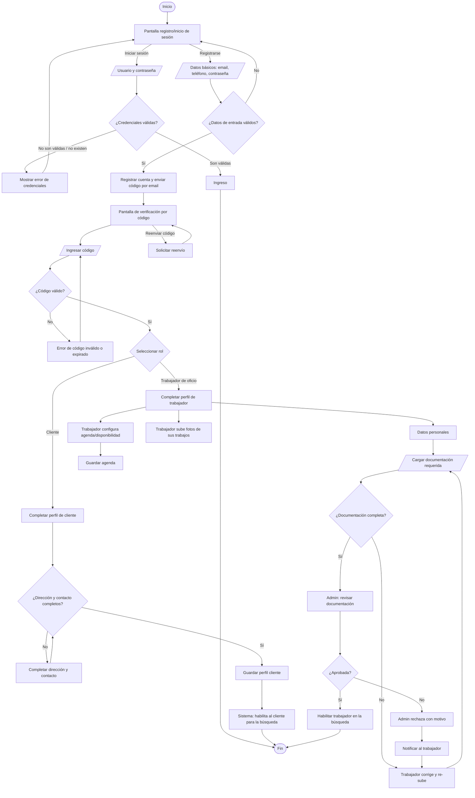
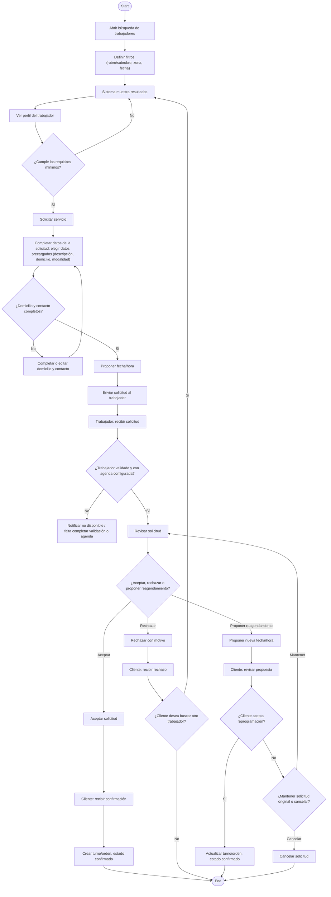
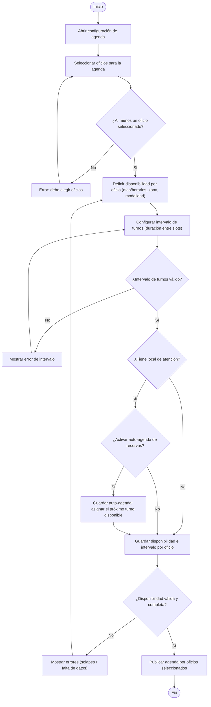
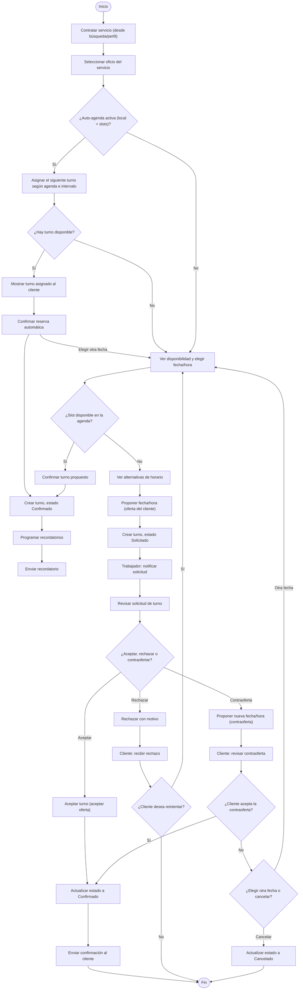
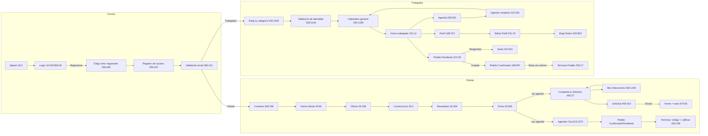

# Plan completo: app Oficios Formosa 1:1 con Figma

- **Fecha:** 20/10/2026.
- **Figma:** `hhKrcrusbr3h6qJxqYBiTd`, páginas Rediseño (3:3) y Flujos (3:2). Solo lectura.
- **Repo:** `Push-Orbita/app-oficios-jetpackcompose`, `main` @ `51f80de`.
- **API:** solo la de producción actual `https://apioficios.pushsoftware.com.ar/api`, spec `openapi-prod-20261020.json`, leída solo con GET.

**Archivos que acompañan este plan:**
- `MAPA_FIGMA_APP.md`: frame por frame.
- `tokens.md`: tokens.
- `backlog-screens.md`: detalle de las pantallas del backlog.
- `contact-sheet.png`: todas las pantallas.
- `screens/<page>/*.png`, `diagrams/*.png`, `ctx/*.txt|.outline`: código de referencia de Figma.

**Cambio de criterio respecto del trabajo anterior.** `docs/DESIGN_ALIGNMENT.md` del repo dejaba asentado "coherencia de flujo por sobre fidelidad pixel-perfect". El objetivo nuevo de Matías es **1:1**. Solo se permiten adaptaciones cuando el comportamiento de la app o la API lo exigen, y cada una está marcada como **[adaptación]**.

> **Descartado por ahora (resuelto en API nueva):** el ítem 2d del backlog (verificar los datos de alta del servicio: rango de fechas contra rango de días). Seguimos en la API vieja, así que quedan fuera de este plan y del orden de PRs el PR-A ("alta de servicio sin 400"), la prueba de alta con POST en prod con cuenta QA y el BK-08.

---

## 1. Inventario y flujos

### 1.1 Inventario
| Página | Frames | Detalle |
|---|---|---|
| Thumbnail 0:1 | — | Logo y portada |
| Rediseño 3:3 | 32 | 30 pantallas de 440×980, más Frame 929 (40:752) y Frame 954 (40:783), que es una imagen de galería |
| Flujos 3:2 | 90 | 82 pantallas, Frame 1030, 6 diagramas de flujo (son imágenes raster: 382:22, 445:6, 447:1134, 451:1145, 526:13, 613:33) y el mapa 475:14 |
| Re-Coloring 537:17 | — | Muestras de color 100×100. No son pantallas |

- **113 frames de pantalla en total**, que se reducen a **33 diseños únicos**. El resto son estados o se repiten entre flujos.
- Estado contra la app, contando frames: **matches 7 · differs 98 · missing in app 7**. Además hay **16 pantallas app-only**. La tabla completa está en `MAPA_FIGMA_APP.md`.
- Ninguna pantalla está 1:1 hoy. Aun las que figuran como "matches" (Splash, Elegí cómo registrarte) difieren por la fuente: no está DIN Pro.

Diseños únicos que no existen en la app:
- "Elegí tu categoría" (grilla multiselección);
- "Elegí Rubro";
- el resumen "Solicitud";
- en parte, el toast "Solicitud enviada" y el bottom sheet "Reagendar".

### 1.2 Flujos, leídos de los diagramas de Figma
Los diagramas son imágenes. Se leyeron renderizados a 3864–4096 px; los recortes están en `diagrams/*-tNN.png`.

**Registro e inicio de sesión (382:22).** Carriles: Usuario / Sistema / Administrador.

Pantallas involucradas:
- login: 356:49, 356:279, 356:343 (error), 366:1865 (incompleto);
- registro: 356:422 / 382:24 / 366:1210;
- validación: 359:859 / 363:911 / 366:964 / 382:110…;
- rol: 356:482;
- contacto: 359:789;
- oficio: 356:596;
- identidad: 356:680;
- home cliente: 366:1030;
- home trabajador (pendiente de validación): 366:1317;
- calendario: 366:1553 / 376:2044.

**Completar el perfil del cliente (445:6):** Iniciar sesión → Ingresar credenciales → ¿Válidas? Si no: ¿Tiene cuenta? (no → Diagrama #1 Registro; sí → reingresar). Si son válidas: ¿Cargó dirección y contacto? (sí → Mostrar pantalla de inicio; no → Pantalla para completar los datos → Cargar contacto y dirección → Seleccionar favorito → Sistema habilita el usuario → Inicio).

**Completar el perfil del trabajador (447:1134).** Carriles: Trabajador / Administrador / Sistema.
- Login → ¿Cargó DNI? Si no: pantalla de validación de identidad → cargar foto del DNI → Admin revisa → ¿Documentación válida? (no: notificar y volver a cargar).
- Con eso → Mostrar pantalla de inicio. Desde ahí: Cargar galería de trabajos / Cargar descripción del oficio y especialización / Cargar certificados / Cargar agenda → Cargar disponibilidad por oficios → ¿Cuenta con local? (sí → Cargar detalles del local) → ¿Se cierra la edición? → Fin.

**Búsqueda (451:1145).** Carriles: Cliente / Trabajador.

Recorrido en pantallas:
- Home 454:467 → Oficios 453:21 → Construcción 453:99 → Resultados 453:206 → Ficha 453:343 ("Solicitar Servicios").
- Si faltan datos: Completa tus datos 454:583.
- Completá tu Solicitud 455:27/460:1017 (o Solicitar Servicio 468:1657 si requiere presupuesto) → Mis Ubicaciones 460:1245/1483/468:1578 (+ mapa 475:14) → Solicitud (resumen) 455:423 → Home con el toast "Solicitud enviada" 475:65.

**Configuración de la agenda (526:13), rol trabajador:**

Pantallas: Home trabajador 526:31 → Agenda 526:667 → Calendario general 526:494.

**Reserva con agenda, cliente ↔ trabajador (613:33):**

Pantallas: 613:40 Home → 613:134 Oficios → 613:214 Construcción → 613:323 Resultados → 613:460 Ficha → **613:1373 Agendar Cita** → 613:572 Pedido Confirmado / 613:637 Pedido Pendiente → 613:704 sheet Reagendar → 613:906 propuesta enviada → 613:982…1249 Terminar Pedido (código + calificación).

### 1.3 Navegación según el rol (resumen de los frames)

La bottom nav es igual para los dos roles: Inicio / Perfil / Favoritos / Ayuda / Ajustes. En el trabajador, "Inicio" lleva a la home de trabajador. **[adaptación]** Pedidos/Mis pedidos no tiene lugar en Figma: hay que decidir dónde va, por ejemplo una sección dentro de Inicio o de Perfil.

---

## 2. Fase 0: alinear el design system (va primero; todo lo demás depende de esto)
Las fuentes y los números de esta sección están en `tokens.md`. Archivos involucrados: `core/designsystem/src/main/java/com/cocido/oficios/core/designsystem/{theme,component}/…`.

| # | Cambio | Archivo | Detalle |
|---|---|---|---|
| DS-1 | **Fuentes DIN Pro (Regular/Medium/Bold) y Satoshi Medium** | `theme/Type.kt` + `res/font/` | Hoy usa `FontFamily.SansSerif`. Hacen falta los `.otf/.ttf` con licencia de app móvil: DIN Pro es comercial (FontFont/Monotype) y Satoshi es gratis (Fontshare/ITF Free Font License). **Bloqueante: que Matías o el cliente consigan la licencia.** **[adaptación]** Si no se consigue, usar un fallback métrico (p. ej. "Barlow"/"D-DIN" OFL) y aceptar una diferencia de ~1–2 px |
| DS-2 | **Escala tipográfica 1:1** | `theme/Type.kt` | Solo 48/36/32/16 (+14 en sistema). `headlineMedium` 28→32. `bodyLarge`/`titleMedium` con ls 0 y line-height "normal" (≈1.2: 19 sp en 16), sin font padding. Nuevo `labelNav` Satoshi 16. Pasar los usos de 12/14/20/22/24 a 16, o a 32/36 donde sean títulos |
| DS-3 | Colores | `theme/Color.kt` | `SecondaryText` #8EABD4→**#7F9AC5** (**decisión de contraste**). Agregar `DisabledText #918E9B`, `ErrorBorder #A32F56`. Confirmar con diseño `#231D38` y el borde/sombra rosados del CTA azul, que parecen restos del tema viejo |
| DS-4 | Espaciado | `theme/Spacing.kt` | Agregar 6 y 10. Nuevo `OficiosScreenPadding = PaddingValues(start=32, top=16, end=32, bottom=32)` y `screenGap = 16` |
| DS-5 | Radios y tamaños | `theme/Radius.kt`, `theme/ComponentSize.kt` | Input `textFieldHeight` 56→**48**. Botón: un solo tamaño (px12 py8 ≈ 35). Avatar cuadrado r8 (48/64). Icon-box 40. Celda de calendario 32. Chip de hora h32 |
| DS-6 | **Iconos Lucide** | `res/drawable/ic_lucide_*.xml` + `OficiosIcons.kt` | Reemplazar las 155 referencias a Material Icons por las ~35 Lucide listadas en `tokens.md` §6 |
| DS-7 | Ilustraciones de categoría y rubro | `res/drawable/ill_*` + `OficiosCategoriesGrid.kt`/`CategoryCard.kt` | Exportarlas de Figma (assets de `ctx/25-258.txt` y `35-2.txt`, que expiran en 7 días). Mapeo nombre→asset local hasta BK-10 |
| DS-8 | `OficiosScreenTitle` | nuevo `component/navigation/OficiosScreenTitle.kt` | Título inline "‹ Título" DIN Bold 36 con `chevron-left` 24 y gap 10 (+ acción a la derecha, p. ej. campana 48). **Reemplaza `OficiosTopAppBar`/`OficiosBackTopBar` (M3 `titleMedium` 16) en todas las pantallas** |
| DS-9 | `OficiosBottomNav` | `component/navigation/OficiosNavigation.kt` | border-top 1 px `#004DA8`, p16 gap16, icon-box 40 r8 (relleno `#004DA8` si está seleccionado; sin la pill de 56×32), label Satoshi 16 blanco, sin escala animada **[adaptación: se puede dejar una animación sutil]** |
| DS-10 | `OficiosButton` | `component/buttons/OficiosButton.kt` | Variantes de Figma: **Primary azul** (#006DEF), **White** (blanco, texto navy, borde #E2E2E2) y **Text** ("Rechazar"). Danger para cancelar (no está en Figma; ver ítem 4). Alto único ≈35 dp (px12/py8), r8, DIN Medium 16. **[adaptación]** área táctil mínima de 48 con `minimumInteractiveComponentSize` sin cambiar el tamaño visual |
| DS-11 | `OficiosTextField` / `OficiosSearchField` | `component/inputs/*` | h48, px16 py12, r8, borde 1 px #004DA8, placeholder 50 % blanco, sin label flotante (Figma no lo usa). Error: borde #A32F56 + mensaje arriba con `circle-alert`. Search con `mic` + `search` al final, `pl16 pr24` |
| DS-12 | Cards | `cards/*` | `OficiosCard` r16, borde 1 px, p16, gap16, fondo = background. `CategoryCard` cuadrada con label arriba y la ilustración. `WorkerCard` según 40:309. `InfoRow` con icon-box 40 + label Bold + valor #7F9AC5 |
| DS-13 | `OficiosCalendar` + `OficiosHourGrid` + `OficiosDayChips` + `OficiosSegmented` | `component/calendar/*` | Calendario mensual: header "‹ marzo 2026 ›" con botones 32 #004DA8, celdas de 32, hoy en círculo blanco con texto navy, seleccionado en círculo #006DEF, con evento r7 #004DA8, fuera de rango #918E9B. Grilla de horas de 4 columnas. Chips de días. Segmentado 30 min/1 h/2 h + reloj |
| DS-14 | `OficiosToastBar` (reemplaza el estilo de `OficiosSnackbar`) | `feedback/OficiosSnackbar.kt` | Banda arriba de la bottom nav: border-top, p16, icon-box 40 + texto + `x`. Variantes success `circle-check`, error `circle-alert`, info |
| DS-15 | `OficiosBottomSheet` | nuevo | Sheet r16 superior + scrim oscuro, como en Reagendar 210:531 y Puntuar 255:199 |
| DS-16 | `OficiosMapCard` | nuevo, usa `maps-compose` (ya está en `libs.versions.toml`) | 376×248 r16 con borde + pin. **[adaptación]** hace falta una API key de Maps; si no hay, usar Static Maps o un placeholder |
| DS-17 | `OficiosRating` | nuevo | 5 × `star`/`star-half` 24 (40 en el sheet de calificar), con número a la izquierda |

**Cómo se verifica la Fase 0.**
- Se agrega un "Design catalog": Paparazzi/Roborazzi con `@Preview` a 440×980 dp y densidad 1x. Ojo que Figma usa un frame de 440 de ancho.
- El diff contra los PNG de Figma se calcula con `screens/...png` reescalado a la misma dimensión. Se usa `compare -metric AE -fuzz 3%` de ImageMagick o `pixelmatch`, con umbral ≤2 % de píxeles.
- Hay que fijar la status bar y el handle de navegación, que en Figma son decorativos: se recortan los primeros 48 px y los últimos 24 px antes de comparar.

---

## 3. Diff por pantalla (los 33 diseños únicos)
Formato: **Figma** (nodos) → `Composable`. Diferencias por layout, tamaño, color, tipografía, íconos, copy y estados. Hay tres cosas que valen para todas las pantallas y no se repiten en cada fila: la fuente (DS-1), los íconos Lucide (DS-6) y el título inline (DS-8).

### Auth y onboarding
1. **Splash** 16:2 / 356:22 / 447:667 → `feature/auth/.../splash/SplashScreen.kt`. Logo 163 + wordmark 48: ya medido (`authLogoWithTitleHeightSplash`). Solo falta la fuente. **matches**.
2. **Login** 16:245 (email) / 16:517 (DNI) / 356:49 / 356:279 → `login/LoginScreen.kt`.
   - Layout: logo + wordmark arriba; "Ingrese sus datos para iniciar sesión" Bold 16; inputs h48 r8; fila "Recordarme" (checkbox r2) + "Ingresar" azul a la derecha; "¿Todavía no tenés cuenta?" + "Registrarse" blanco; card de ayuda con "?" y "Contactar".
   - Copy: Figma usa "Ingrese…" (usted) y la app "Ingresá…". "Registrarse" vs "Registrate". Texto de ayuda largo: "Para cualquier consulta o duda de asistencia, por favor, no dude en contactar a nuestra línea de atención:". **Decisión:** Figma mezcla usted y vos ("¿Ya tenés cuenta?"); se propone copiar Figma literal.
   - "¿Olvidaste tu contraseña?" es app-only: se mantiene **[adaptación]**.
   - DNI vs Correo: Rediseño 16:517 usa D.N.I. y todos los Flujos usan Correo. La API de prod hace login por email, así que **queda Correo**.
3. **Login con error** 356:343 / 366:1865 → `LoginScreen.kt`. El mensaje va arriba del formulario ("Los datos de sesión no coinciden" / "Complete los datos para ingresar") con `circle-alert` 24, y los inputs con borde #A32F56. En la app el error es inline bajo el campo y en #BA6380. Copy: "Completá los datos para ingresar" → "Complete los datos para ingresar".
4. **Elegí cómo registrarte** 356:482 / 447:573 → `register/RegisterScreens.kt#RegisterRoleSelectionScreen`. Ya medido. **matches**; solo falta la fuente.
5. **Registro de usuario/cliente** 16:572 / 356:422 / 382:24 / 366:1210 → `RegisterFormScreen`.
   - Inputs h48 (hoy 56) sin label flotante.
   - Hint "Te enviaremos un código para validar el correo electrónico ingresado" en 50 %.
   - Checkbox de términos + "Siguiente" azul.
   - Error "Las contraseñas no coinciden" bajo el campo. Ojo: Figma tiene el typo "constraseñas".
   - Copy: "Ingrese sus datos para crear su cuenta".
6. **Validación de email** 359:859 / 363:911 / 366:964 / 382:110 / 382:187 / 382:141 / 382:297 → `onboarding/verify/VerifyEmailStepScreen.kt`.
   - Elementos de Figma: "Validación" 36; "Validación de correo electrónico" Bold; texto + email Bold; botón "Abrir correo" (blanco); casillas de código; "Omitir"/"Omitir por ahora"; "¿No recibiste el código? Reenviar código en 00:56" + "Reenviar código"; estados "Código validado" (`circle-check`) y "Código Inválido"; "Continuar".
   - **[adaptación]** Figma dibuja 4 casillas y la API usa 6 dígitos (`onboarding_step_verify_email_subtitle`): se hacen 6 casillas con el mismo estilo.
   - Faltan "Abrir correo" (Intent `CATEGORY_APP_EMAIL`) y "Omitir". Omitir solo vale si el backend permite continuar sin verificar; si no, se oculta.
7. **Contacto / Completa tus datos** 359:789 / 382:71 / 447:543 / 447:1044 / 454:583 → `steps/OnboardingStepScreens.kt#ClientContactDomicilioStepScreen`.
   - Una sola pantalla: Teléfono (hint de validación), Domicilio, fila Barrio/Piso/Dpto en 3 columnas y "Continuar" a la derecha.
   - La app lo maneja con un checklist de pasos y topbar. Hay que unificar el layout. El checklist puede quedar como lógica, sin pantalla visible **[adaptación]**.
8. **Registro de oficio (versión vieja)** 25:337 / 356:596 → `register/RegisterTradeScreen.kt`. Ya funciona; queda reemplazado por el 9 **[decisión: usar la versión de Flujos 526:1026]**.
9. **Elegí tu categoría** 526:1026 / 527:57 / 527:168 / 527:294 → **MISSING** (hoy dropdowns en `RegisterTradeScreen`/`ProviderRubrosStepScreen`).
   - Grilla de 2 col de categorías multiselección (seleccionada con fondo #004DA8).
   - Por categoría: select de rubro; "Especializado en:" con **radios** (`circle`/`circle-dot`) + "Otro: Completar abajo" + "Ingresar otro".
   - "Rango de Experiencia", "Barrio" con buscador, "Horario de atención" Desde/Hasta + "Añadir otro horario".
10. **Validación de Identidad** 25:767 / 356:680 / 526:1118 → `ProviderDniStepScreen` + `ProviderSelfieStepScreen`.
    - Una sola pantalla: Frente del D.N.I. (selector "Seleccione una foto" + nombre de archivo + "Seleccionar archivo") / Dorso / Foto del Rostro (preview grande + "foto.jpg" + "Volver a tomar la foto") / "Certificado de Oficio (Opcional)" / "Continuar".
    - La app lo reparte en 2–3 pasos.
11. **Calendario general (onboarding)** 366:1553 / 376:2044 / 526:1169 → ver el 27.

### Cliente
12. **Home cliente** 25:95 / 356:104 / 447:951 / 454:467 / 613:40 → `feature/home/HomeScreen.kt`.
    - Padding: Figma pt16 px32 pb32 gap16; la app tiene 24/16/24.
    - Header: avatar 48 r8 (la app usa un avatar circular), nombre Bold 16 + `badge-check`, campana 48 con fondo #004DA8 r8.
    - Buscador: falta `mic`. Hint "¿Qué oficio estás buscando?" (Flujos); hoy "¿En qué podemos ayudarte?".
    - **Quitar** el `OficiosActionCard` "Mis pedidos" y "Trabajadores destacados", que no están en Figma. **[adaptación]** Mis pedidos se reubica (ver §1.3).
    - "Recientes" 36 con 3 cards de rubros recientes: hoy `HomeRecentSearchesSection` muestra búsquedas en texto.
    - **Agregar** la card de ayuda con "Contactar" (reusa `auth_support_*`).
    - Bottom nav: DS-9.
    - Variante 366:1030 (home recién registrado): grilla de categorías en la misma home.
13. **Home + toast** 475:65 → `HomeScreen` + DS-14. Mostrar "Solicitud enviada" al volver de CreateOrder. Hoy CreateOrder navega sin feedback.
14. **Oficios (categorías)** 25:258 / 453:21 / 613:134 → `CategoriesScreen.kt`.
    - Título inline "‹ Oficios" 36 + campana 48.
    - Buscador "¿Qué oficio estás buscando?" con mic/search.
    - Grilla de 2 col de cards cuadradas r16 con label 16 arriba e ilustración (DS-7). Hoy los íconos son Material (`OficiosCategoriesGrid`).
    - Agregar la card "Ver todos" (`book-user`).
15. **Rubros (Construcción)** 35:2 / 453:99 / 613:214 → `rubros/RubrosScreen.kt`. Hoy es una **lista** con `headlineMedium`; tiene que ser una grilla de 2 col con ilustración por rubro y título 36.
16. **Resultados** 40:309 / 453:206 / 613:323 → `search/SearchResultsScreen.kt` + `core/.../cards/WorkerCard.kt`.
    - Header logo 61×101 + "{Rubro plural} de Oficios Formosa" 36.
    - Aviso del límite de contacto en 50 %.
    - Buscador "¿Buscas algún {rubro} en específico?".
    - Card:
      - avatar 64 **r8**;
      - `shield-check` en vez del ícono de la app;
      - rating con **número + 5 estrellas** (hoy 1 estrella + número) o "Sin Calificación";
      - especialidad en #7F9AC5;
      - **"Contactar" Primary azul** y "Ver ficha completa" White (hoy los dos son Secondary);
      - copy "Ver ficha completa" (hoy `home_worker_view_profile`).
    - **[adaptación]** chips y filtros: Figma no los tiene. Se propone un ícono de filtro discreto o sacarlos (decisión de Matías).
17. **Ficha completa** 40:559 / 453:343 / 613:460 → `worker/WorkerProfileScreen.kt`.
    - Título 36 inline. Avatar 64 r8 + nombre + `shield-check`. 5 estrellas. `heart` a la derecha (favorito).
    - Bio 16. "Oficios:" y "Especializado en:" en Bold con el valor en #7F9AC5.
    - CTA: Flujos usa **"Solicitar Servicios"** blanco a la derecha (vigente); Rediseño usa Contactar/Calificar. La app tiene "Contratar" + "Calificar" + "Denunciar".
    - "Trabajos realizados" 32 con galería horizontal r8; certificados; reseñas con fecha "25/02/2025, 08:27:46".
    - **[adaptación]** "Denunciar perfil" se mantiene (app-only, va al final, en texto chico).
18. **Completá tu Solicitud** 455:27 / 460:1017 → `orders/CreateOrderScreen.kt`.
    - Modalidad: segmentado Presupuesto | Trabajo.
    - Descripción: textarea.
    - Ubicación: lista radio + estrella favorita + "Añadir nueva ubicación" (`circle-plus`).
    - Fecha y hora: `OficiosCalendar` + `OficiosHourGrid`.
    - "Continuar" a la derecha.
    - Hoy hay dropdowns de especialidad, domicilio y contacto, una lista de slots y `DateTimePickerButton`.
    - Título "Completá tu Solicitud" (hoy "Contratar").
19. **Solicitar Servicio (requiere presupuesto)** 468:1657 → mismo Composable + `OficiosInlineAlert` "Este trabajador requiere un presupuesto antes de realizar un trabajo." (`circle-alert` + `x`).
20. **Mis Ubicaciones** 460:1245 / 460:1483 / 468:1578 → `feature/settings/.../client/ClientDataScreen.kt`, o un sheet nuevo desde CreateOrder.
    - Input "Agrega la nueva ubicación" + `map-pin-house`; "Marcar en el mapa" (mapa 475:14); "Podes guardar la ubicación…"; lista con estrella; "Guardar".
    - La app mezcla contactos y domicilios ("Contactos y domicilios"). Figma separa ubicaciones, y el contacto va en "Completa tus datos".
21. **Solicitud (resumen)** 455:423 → **MISSING**. Pantalla de confirmación con mapa + Detalle/Dirección/Tiempo de visita + "Realizar cambios" (azul) / "Enviar Solicitud" (blanco).
22. **Agendar Cita** 613:1373 → `CreateOrderScreen.kt` (rama con slots). Card del trabajador arriba, calendario y grilla "Horario" (hoy LazyColumn de `OficiosScheduleSlot`).
23. **Pedido Confirmado** 198:697 / 613:572 → `orders/OrderDetailScreen.kt`.
    - Título por estado 36 ("Pedido Confirmado/Pendiente", "Terminar Pedido").
    - `OficiosMapCard` 248 (hoy se abre un Intent externo `openOrderMap`).
    - 5 `InfoRow` con icon-box 40 y los íconos `receipt-text`/`map-pin-house`/`user`/`clock`/`dollar-sign`.
    - Chip de pago "Efectivo" `banknote`.
    - CTAs a la derecha: "Contacto" azul y "Estoy en camino" blanco (tracking ✅ API).
    - **Quitar** `OrderProgress` (timeline) y `OrderClosedBanner`, que no están en Figma. **[adaptación]** Se puede conservar un chip de estado chico si hace falta para estados que Figma no dibuja (Cancelado, Rechazado).
    - Sin bottom nav.
24. **Pedido Pendiente** 210:29 / 613:637 → `OrderDetailScreen.kt`. CTAs del trabajador: "Rechazar" (Text) + "Reagendar" (Primary) + "Aceptar" (White). Monto "Presupuesto pendiente".
25. **Reagendar (sheet)** 210:531 / 455:488 / 613:704 + enviado 215:769 / 613:906 → `orders/CounterOfferScreen.kt` pasa a ser un `OficiosBottomSheet`.
    - Contenido: calendario; hora con `‹ 12 : 30 ›` (chevrons); "Tiempo de visita actual" / "Nuevo tiempo de visita propuesto"; "Cancelar" / "Enviar Reagenda".
    - Estado enviado: banda "Nueva propuesta enviada: …" + "Aceptar", con Rechazar/Aceptar Pedido deshabilitados.
26. **Terminar Pedido** 255:17 / 255:101 / 255:199 / 255:331 / 255:452 / 613:982…1249 → `OrderDetailScreen.kt` (`CompletionCodeCard`, `FinalizeCodeDialog`) + `RateWorkerScreen.kt`.
    - Trabajador: input inline "Ingresar código del cliente" + "Validar" (hoy es un diálogo).
    - Cliente:
      - fila "Código:" con el valor "3456" en un chip blanco;
      - diálogo informativo con "No volver a mostrar" + "Aceptar" (nuevo; se persiste en DataStore);
      - calificación en un **sheet** "Puntuar al trabajador de oficio": avatar + nombre + número + 5 estrellas 40 + "Enviar" → "Enviado" (azul), y comentario opcional.
    - Hoy la calificación es una pantalla aparte con 2 criterios (calidad/puntualidad). **[adaptación API]** Prod exige `calidad` y `puntualidad`, así que el sheet lleva 2 filas de estrellas con el mismo estilo (o BK-17).

### Trabajador
27. **Calendario general** 239:475 / 366:1553 / 376:2044 / 526:494 / 526:1169 → hoy `agenda/AgendaConfigScreen.kt` (duración e intervalo con campos numéricos) + `AgendaListScreen.kt` (CRUD de slots) + `ProviderAvailabilityStepScreen` (franjas Desde/Hasta).
    - Figma: Días de Atención (chips, hacen de selector del día que se edita), División de Horarios (30 min/1 h/2 h/personalizada), grilla de horas 4×6 (máx. 12 h por día), "Calendario Por Oficio" con checkbox + resumen + chevron.
    - **Es una sola pantalla nueva que reemplaza las tres.**
28. **Home trabajador** 191:11 / 259:17 / 259:254 / 366:1317 / 366:1737 / 526:31 → `providerhome/ProviderHomeScreen.kt`.
    - Header con nombre + oficios ("Albañil, Electricista") o "Pendiente de validación".
    - "Beneficios": 3 cards en fila r8 #004DA8 con texto Bold parcial (hoy 2 estáticas).
    - "Completa Tu Perfil": barra 80 % + 3 tiles ("Agrega fotos a tu galería" / "Agrega tu local comercial" / "Agrega un certificado" con `circle-check`/`circle-dashed`) + "completar perfil". Hoy `ProfileCompletionCard` con un % en saltos de 25.
    - Card "Calendario: Configura tu calendario… / Configurar Agenda" en 366:1317.
    - "Agenda": calendario + lista por fecha + "ver agenda completa".
29. **Agenda trabajador** 259:534 / 526:667 → `agenda/AgendaListScreen.kt`. Calendario y lista agrupada "4 de marzo" con cards con barra lateral (hoy #006DEF) + chevron. Hoy tiene vista semana/mes y CRUD: el CRUD pasa al Calendario general (27).
30. **Agenda completa** 210:106 → `AgendaListScreen.kt`. Lista con checkboxes por servicio + "ajustar calendario" (link al 27).
31. **Perfil** 198:373 → **[parcial]** `settings/provider/ProfessionalProfileScreen.kt` + `PortfolioScreen.kt`.
    - Figma tiene una sola pantalla del tab "Perfil": "Foto de Perfil:", descripción, "Oficios:", "Especializado en:", "Trabajos realizados" 32, certificados, botón "Editar" blanco arriba a la derecha.
    - En la app el tab Perfil muestra "Próximamente" (ver `DESIGN_ALIGNMENT.md`) y estas partes viven en Ajustes.
32. **Editar Perfil** 224:1077 / 230:20 / 231:15 → los mismos más `ServicesScreens.kt`.
    - Foto con Eliminar (Danger) / Inspeccionar; descripción editable; "Editar Rubro o Especialidad" (`pencil`); galería con "+ Añadir"; certificados con estado (Validado/Pendiente); "Darme de baja" (`DeleteAccount`).
33. **Elegí Rubro** 526:903 / 526:986 → **MISSING**. Primer paso del alta de servicio (`AddServiceScreen` hoy usa dropdown). Grilla multiselección + "Continuar" (deshabilitado/habilitado).

### App-only (fuera de Figma, se mantienen con estilo derivado)
- ForgotPassword/Reset, Terms;
- checklists de onboarding y estados Pending/Rejected/Blocked/Inactive;
- VerifyPhone;
- OrdersList, Notifications, Favorites, Help, WorkerReport;
- Settings, PersonalData, ChangePassword, DeleteAccount;
- lista de Servicios;
- SearchFilterBottomSheet.

Estas pantallas se pasan a los mismos componentes (título 36 inline, inputs 48, Lucide) para que queden coherentes. **Pedir a diseño:** cancelar pedido + plazo, Mis pedidos, Notificaciones, Favoritos, Ayuda y Ajustes.

---

## 4. Backlog de la reunión integrado
El detalle técnico está en `/workspace/oficios-dev-api/PLAN_BACKLOG_REUNION.md`.

| Ítem | Pantallas Figma | Se integra en |
|---|---|---|
| 1a Servicio editable | Editar Perfil 231:15 ("Editar Rubro o Especialidad"), Elegí Rubro 526:903 | PR-10 (Perfil/Editar), con `PATCH /trabajador-oficio-rubro/{id}` en lo editable. Lo demás queda bloqueado por BK-01 |
| 1b Agenda editable | Calendario general 239:475, Agenda completa 210:106 | PR-9 (Calendario general). Duración = "División de Horarios" → `sesion` (borrar y recrear hasta BK-03). Bloqueos: BK-04 |
| 1c Horario por día | Calendario general (chips de día + grilla de horas) | PR-9: modelo `Map<Día, Set<Hora>>` → `diasLaborales[]` con `diaInicio = diaFin` en el alta; editar después necesita BK-02 |
| ~~2d Datos de alta del servicio~~ | — | **Descartado por ahora (resuelto en API nueva).** Sin PR-A ni prueba POST con QA |
| 2a Reserva según disponibilidad | Agendar Cita 613:1373, Completá tu Solicitud 455:27 | PR-7 (Reserva/Solicitud): días deshabilitados #918E9B según `diasLaborales` + slots |
| 2b Cancelar | (no está en Figma) | PR-6 (Detalle del pedido): motivo obligatorio también para el trabajador, `fechaLimiteCancelacion` como InfoRow `clock` |
| 2c Plazo de cancelación | (no está en Figma) | PR-10: campo en Editar Rubro (12–168 en prod; el pedido es 1–24 → BK-06) |
| 2e Toasts | Toast 475:65, errores de login 356:343, código 363:911 | PR-1 (DS-14) + uso de `showSuccess` en las 13 rutas (PR-3) |
| 2f Tiempo real | Estados de Pendiente/Reagendar/Confirmado | PR-6: polling 10–15 s (y PR-12 push cuando haya Firebase de prod) |
| 3 Imágenes y certificados | Ficha 40:559, Editar Perfil, Frame 954 | PR-5 (Ficha) y PR-10 (galería multi-foto, estado de certificados) |
| 4 Cancelar como primario | (no está en Figma) | PR-6: `OficiosButton` Danger con la medida de los CTAs de Figma, alineado con los demás CTAs. **Pedir el frame a diseño** |
| 5 Rediseño del buscador | 25:95 → 25:258 → 35:2 → 40:309 → 40:559 | PR-4: home, categorías, rubros en grilla, resultados con header/aviso/buscador en el rubro, WorkerCard |

---

## 5. Gaps de API por pantalla (solo prod actual)
BK-01…BK-13 están en `PEDIDO_BACKEND_backlog_reunion.md`. **BK-08 descartado** (2d, resuelto en API nueva). Los BK-14…BK-18 salen del Figma.

| Pantalla Figma | Qué necesita | ¿Prod lo soporta? | Gap |
|---|---|---|---|
| Home cliente "Recientes" (cards de rubro) | Rubros recientes del usuario | ❌ no hay endpoint. **[adaptación]** guardar localmente (DataStore) los últimos rubros visitados | — (local) |
| Oficios / Construcción con ilustraciones | Imagen por categoría/rubro | ❌ `CategoriaDTO {id,nombre}` | BK-10 (por ahora assets locales) |
| Resultados: búsqueda por categoría | `categoriaId` en search | ❌ | BK-12 |
| Resultados: "No puedes contactar a más de 3 trabajadores en 10 minutos" | Regla y código de error | ❌ no está documentado | **BK-14:** documentar o implementar el límite de contacto (3 en 10 min) con 429 + `code` (p. ej. `CONTACT_RATE_LIMITED`) y, opcional, `retryAfter` |
| Resultados: "¿Buscas algún albañil en específico?" | `q` = nombre dentro del rubro | ⚠️ `q` existe pero no está documentado qué busca | BK-12 |
| Ficha: favorito (corazón) | Favoritos de trabajador | ✅ `/favoritos`, `/favoritos/trabajador-oficio/{trabajadorOficioId}` | — |
| Ficha: reseñas con fecha y comentario | Reseñas | ✅ (ya se muestran) | — |
| Completá tu Solicitud: Modalidad Presupuesto/Trabajo | Tipo de solicitud | ❌ `CreateSolicitudServicioRequestDto` = {trabajadorOficioSubRubroId, domicilioId, contactoId, slotTurnoId, fechaPropuestaInicio/Fin, descripcion} | **BK-15:** campo `tipo` (PRESUPUESTO/TRABAJO) en la solicitud + flag `requierePresupuesto` en el subrubro del trabajador (para 468:1657) |
| Mis Ubicaciones: favorita, "Marcar en el mapa" | Domicilio con lat/lng y favorito | ✅ `/domicilios` (`CreateDomicilioRequestDto` trae `latitud`/`longitud`/`favorito`), `PATCH /domicilios/{id}/favorito` | — |
| Agendar Cita / Fecha y hora | Días y horas disponibles | ✅ con turnos (`/agenda/slot/disponibles`); ❌ sin turnos | BK-05 |
| Pedido Confirmado: mapa | lat/lng del domicilio en el detalle | ✅ (la app ya abre el mapa con lat/lng) | — |
| Pedido Confirmado: "Estoy en camino" | Tracking | ✅ `POST /tracking-booking/booking/{bookingId}/marcar` | — |
| Pedido Pendiente: Reagendar | Contraoferta | ✅ `PATCH /solicitud-servicio/{id}/contraofertar` | — |
| Cancelar (sin frame) | Motivo + plazo | ⚠️ motivo ✅; plazo 12–168 | BK-06, BK-07 |
| Reserva automática + recordatorios (613:33) | Auto-aceptación ✅ (`autoAceptacion`); recordatorios | ❌ recordatorios | **BK-16:** recordatorios de turno (push programado) — baja |
| Terminar Pedido: código / calificación | Código y rating | ✅ `completion-code`. ⚠️ `CreateCalificacionRequestDto` **exige `calidad` + `puntualidad`** (+ `comentario` opcional) y Figma tiene un solo puntaje | **[adaptación]** 2 filas de estrellas dentro del sheet, o **BK-17:** aceptar un puntaje único |
| Calendario general: días + horas por día + división | Editar `diasLaborales` y `sesion` | ⚠️ solo en el alta | BK-02, BK-03, BK-04 |
| Calendario por oficio (override) | Disponibilidad por subrubro | ⚠️ aclarar si `diasLaborales` es por rubro o por subrubro | BK-05 |
| Home trabajador: Beneficios | Contenido de beneficios | ❌ (estático en la app) | **BK-18:** endpoint de beneficios (baja; puede quedar estático) |
| Home trabajador: % de perfil + tiles | Hitos (galería, local, certificado) | ⚠️ `estado-perfil` da hitos booleanos, no un % | Derivar en la app **[adaptación]** |
| Editar Perfil: Editar Rubro o Especialidad | Editar subrubros y modalidad | ❌ | BK-01 |
| Editar Perfil: certificados Validado/Pendiente | Estado del certificado | ⚠️ | BK-11 |
| Validación de email: "Omitir" | Continuar sin verificar | ⚠️ depende del gate de onboarding | Confirmar con backend |
| Push (todas las pantallas de pedido) | Firebase de prod | ❌ stub | BK-09 |

---

## 6. PRs en orden (se pueden publicar uno por uno)
El tamaño es S ≤1 día, M 2–3 días, L 4–6 días. Todos se verifican igual:
- capturas Paparazzi/Roborazzi a 440×980 @1x, más una captura de emulador (Pixel 8 Pro, ancho 440 dp en modo "display size" por defecto: confirmar con `adb shell wm size/density`);
- diff contra `/workspace/figma-oficios/screens/...png` recortando la status bar y el handle; umbral ≤2 % de píxeles distintos (`compare -metric AE -fuzz 3%`);
- revisión visual lado a lado en el PR, con la imagen de diff adjunta.

Antes de PR-1 conviene agregar el script `tools/figma_diff.sh` (S): toma un PNG de Figma y uno del emulador, normaliza el tamaño, recorta y genera el diff + porcentaje.

| # | PR | Alcance | Tamaño | Depende de | Verificación |
|---|---|---|---|---|---|
| PR-0 | Infra de screenshot diff | Paparazzi/Roborazzi + `figma_diff.sh` + carpeta `design-baselines/` con los PNG de Figma | S | — | CI genera el diff |
| PR-1 | **DS: tokens** | DS-1…DS-5 (fuentes si hay licencia, escala, colores, espaciado, radios, tamaños) | M | Licencia de las fuentes | Catálogo de previews contra `tokens.md`; snapshot de los textos de referencia |
| PR-2 | **DS: componentes** | DS-6…DS-17 (Lucide, ilustraciones, ScreenTitle, BottomNav, Button, TextField/Search, Cards, Calendar/HourGrid/DayChips/Segmented, ToastBar, BottomSheet, MapCard, Rating) | L | PR-1 | Un preview por componente contra el recorte del nodo Figma (p. ej. el botón 40:518, la nav 25:150, la card 40:492) |
| PR-3 | Auth y onboarding 1:1 + toasts de error/éxito | Splash, Login (+ errores), Rol, Registro, Validación (6 casillas, Abrir correo), Contacto unificado, Identidad en 1 pantalla. Wiring de `showSuccess`/`showError` en las 13 rutas (2e) | M | PR-2 | Diff de 16:2, 356:49, 356:343, 366:1865, 356:482, 356:422, 366:1210, 382:110, 363:911, 359:789, 526:1118 |
| PR-4 | **Buscador rediseñado (5)** | Home cliente (Recientes local, card de ayuda, sin Mis pedidos/Destacados), Oficios, Rubros en grilla, Resultados (header/aviso/buscador en el rubro), WorkerCard | M | PR-2 | Diff de 25:95, 25:258, 35:2, 40:309 |
| PR-5 | Ficha completa + imágenes (3) | WorkerProfileScreen 1:1, "Solicitar Servicios", galería, certificados, reseñas | S–M | PR-2 | Diff de 40:559 / 453:343 |
| PR-6 | **Detalle del pedido + cancelación + tiempo real (2b, 4, 2f polling)** | Confirmado/Pendiente/Terminar 1:1, MapCard, InfoRows, Reagendar como sheet, código inline, calificar en sheet. Cancelar Danger con motivo obligatorio y `fechaLimiteCancelacion`. Polling 10–15 s | L | PR-2 | Diff de 198:697, 210:29, 210:531, 215:769, 255:17, 255:199, 255:452. Test del motivo obligatorio (unit) |
| PR-7 | **Solicitud y reserva (2a)** | Completá tu Solicitud (ubicaciones, calendario + horas, días no disponibles), Mis Ubicaciones, resumen "Solicitud", Agendar Cita, toast "Solicitud enviada". **[adaptación]** el segmentado Presupuesto/Trabajo queda oculto hasta BK-15 | L | PR-2, PR-4 | Diff de 455:27, 460:1017, 460:1245, 455:423, 613:1373, 475:65 |
| PR-8 | Home trabajador | Beneficios 3 cards, Completa tu Perfil con tiles, card Configurar Agenda, Agenda + lista | M | PR-2 | Diff de 191:11, 366:1317, 259:534 |
| PR-9 | **Calendario general (1b, 1c)** | Pantalla nueva que reemplaza AgendaConfig, el CRUD de slots y el paso de disponibilidad: días, división, grilla de horas, por oficio. Alta: `diasLaborales` por día. Edición: borrar y recrear `sesion`/slots hasta BK-02/03 | L | PR-2 | Diff de 239:475, 526:494, 210:106. Test de mapeo `Map<Día,Set<Hora>>` → `diasLaborales` |
| PR-10 | Perfil y Editar Perfil (1a, 2c parcial, 3) | Tab Perfil real, Editar Perfil, Elegí Rubro, "Editar Rubro o Especialidad" con lo que permite el PATCH (auto-aceptación, principal, plazo 12–168), galería multi-foto, estado de certificados | M–L | PR-2 | Diff de 198:373, 231:15, 224:1077, 526:903 |
| PR-11 | Registro de oficio "Elegí tu categoría" | Grilla multiselección + radios de especialización en el registro/onboarding del trabajador | M | PR-2 | Diff de 526:1026, 527:294 |
| PR-12 | Push en tiempo real (2f) | FCM de prod | M | BK-09 | Prueba manual en el emulador con push de staging |
| PR-13 | App-only coherentes | Forgot, Settings, Mis pedidos, Notificaciones, Favoritos, Ayuda, estados de onboarding con los componentes nuevos | M | PR-2 | Revisión visual (no hay baseline de Figma) |

**Bloqueantes y decisiones para Matías**
1. Licencia de DIN Pro (y Satoshi), o aprobar un fallback.
2. Bajar `SecondaryText` a #7F9AC5 (1:1) o mantener #8EABD4 (AA).
3. Copy en "usted" (Figma) o en "vos" (app).
4. Login: queda Correo (API) y no DNI.
5. Dónde va "Mis pedidos" y si se mantienen los filtros de búsqueda (app-only).
6. Pedirle a diseño los frames de cancelar pedido/plazo, Notificaciones, Favoritos, Ayuda y Ajustes.
7. Restos violeta en Figma (#231D38 y el borde rosado del CTA azul): ¿copiarlos o corregirlos?
8. API key de Google Maps para `OficiosMapCard`.

## Decisiones de Matías (20/10/2026 14:17, UTC-3)
1. Fuentes: alternativa libre parecida (D-DIN OFL en lugar de DIN Pro; Satoshi es gratuita).
2. Trato: "usted" (como Figma).
3. Login: por correo.
4. Se mantienen los filtros del buscador y "Mis pedidos" en la barra inferior. "Ayuda" sale de la barra inferior y pasa a Ajustes.
5. Pantallas que no están en Figma (cancelar pedido, plazo de cancelación, Notificaciones, Favoritos, Ayuda, Ajustes): se diseñan siguiendo el lenguaje visual del resto del Figma.
