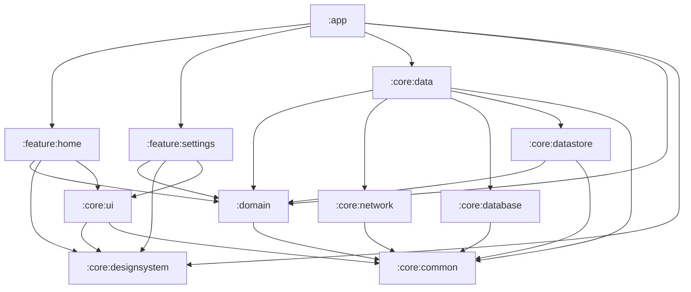

# Arquitectura

## Visión general

Oficios implementa **Clean Architecture pragmática** adaptada a Android moderno. No es over-engineering: cada capa tiene una responsabilidad clara y las dependencias fluyen en una sola dirección.

## Capas

### UI Layer (`:app`, `:feature:*`)

**Responsabilidad:** Presentación y interacción.

- Composables stateless (`*Screen`)
- Conexión ViewModel (`*Route`)
- ViewModels con `StateFlow<UiState>`
- Eventos de usuario (`*Event` o callbacks)
- Sin lógica de negocio ni acceso directo a Retrofit/Room/DataStore

### Domain Layer (`:domain`)

**Responsabilidad:** Reglas de negocio y contratos.

- Modelos de dominio puros
- Interfaces de repositorio
- Use cases (cuando aportan claridad)
- **Sin dependencias de Android Framework**

### Data Layer (`:core:data`, `:core:network`, `:core:database`, `:core:datastore`)

**Responsabilidad:** Obtener y persistir datos.

- Implementaciones de repositorios
- Data sources (remote/local)
- DTOs y mappers
- Módulos Hilt por infraestructura

### Core Layer (`:core:common`, `:core:model`, `:core:designsystem`, `:core:ui`)

**Responsabilidad:** Utilidades transversales.

- `common`: Result, errores, dispatchers
- `designsystem`: tokens y componentes visuales
- `ui`: layouts/helpers de UI no pertenecientes al DS

## Diagrama de dependencias



## Manejo de errores

```kotlin
sealed interface AppResult<out T> {
    data class Success<T>(val data: T) : AppResult<T>
    data class Error(val error: AppError) : AppResult<Nothing>
}

sealed interface AppError {
    data class Network(...)
    data class Validation(...)
    data class Unknown(...)
}
```

Flujo:

1. Excepción en data layer → `toAppError()` o `safeApiCall`
2. Use case devuelve `AppResult`
3. ViewModel mapea a `UiState.Error`
4. UI muestra `AppErrorState` o Snackbar

## Inyección de dependencias

| Módulo Hilt | Ubicación |
|-------------|-----------|
| `NetworkModule` | `:core:network` |
| `DatabaseModule` | `:core:database` |
| `PreferencesModule` | `:core:datastore` |
| `DataModule` / `CoreModule` | `:core:data` |

ViewModels usan `@HiltViewModel`. Application usa `@HiltAndroidApp`.

## Escalabilidad

### Cuando agregar un módulo feature

Al tener 2+ pantallas relacionadas con lógica propia.

### Cuando extraer `:core:testing`

Al repetir fakes/rules en 3+ módulos.

### Cuando agregar `build-logic`

Al tener 5+ módulos android con configuración duplicada.

### Nested navigation graphs

Cada feature puede exponer su propio `NavGraphBuilder` anidado cuando crezca:

```kotlin
navigation(startDestination = ProfileDestination.route, route = "profile_graph") {
    profileScreen(...)
    editProfileScreen(...)
}
```

## Testing strategy

| Tipo | Qué testear | Dónde |
|------|-------------|-------|
| Unit | Use cases, ViewModels, mappers | `src/test` |
| Fake repos | Contratos de domain | junto al test |
| UI Compose | Componentes DS, pantallas clave | `src/androidTest` |

La UI no se testea con repos reales. Los ViewModels reciben use cases con fakes.
